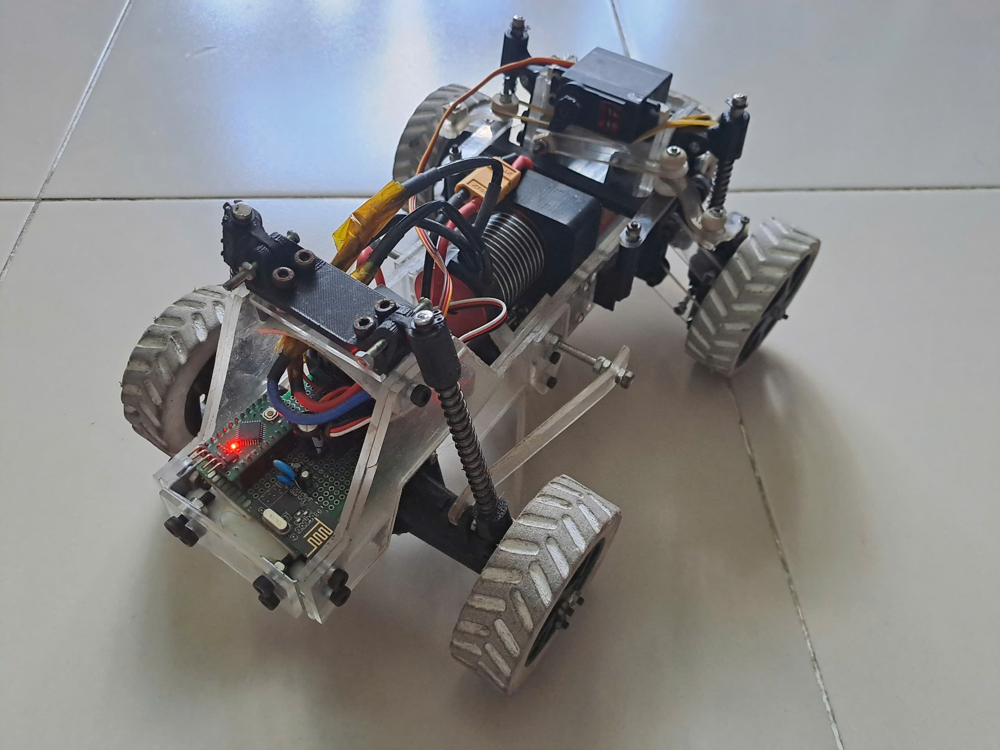
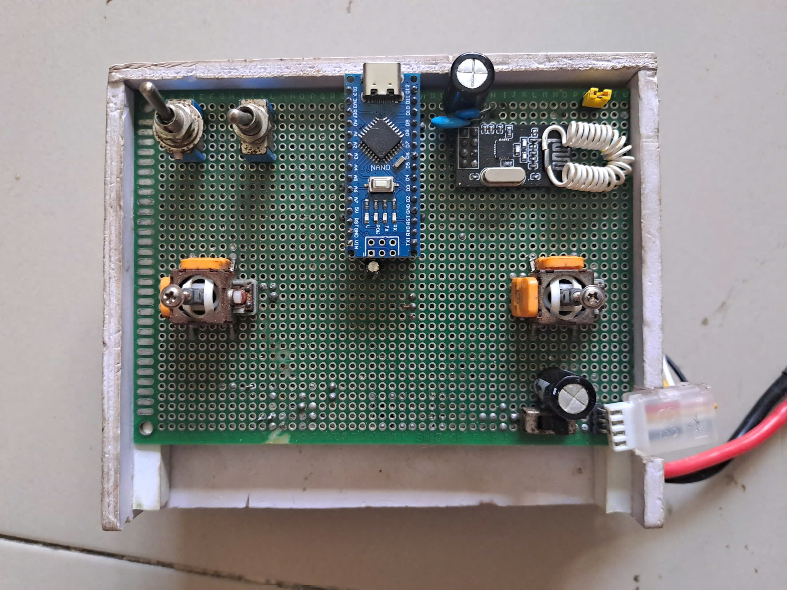
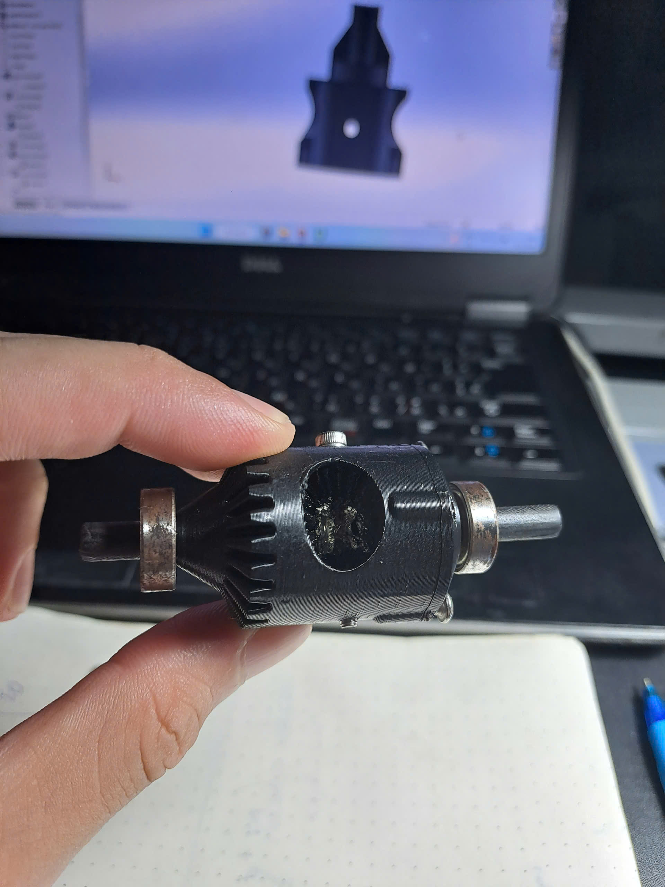

# RC Car
Xe điều khiển từ xa tốc độ cao với bộ điều khiển TX-RX sử dụng module RF nRF24L01.

# TX-RX controler
Bộ điều khiển từ xa với sóng 2.4GHz thông qua module nrf24l01

# Differential
Thiết kế hệ thống dẫn động cầu sau cho xe, với vi sai in 3d
https://github.com/user-attachments/assets/12b59e3c-bfab-4d66-8a31-8e2925f82b3c
<table>
  <tr>
    <td width="50%" align="center">
      <video src="https://github.com/user-attachments/assets/12b59e3c-bfab-4d66-8a31-8e2925f82b3c" controls width="80%"></video>
       
    </td>
    <td width="50%" align="center">
      
       
    </td>
  </tr>
</table>

# Video demo
https://github.com/user-attachments/assets/64d63a98-ecf7-4508-ad81-e11049c115cf

